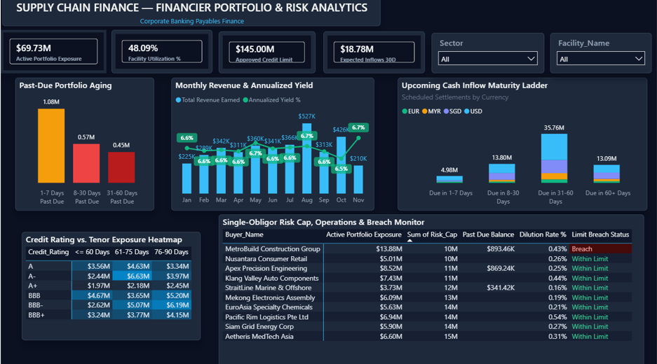
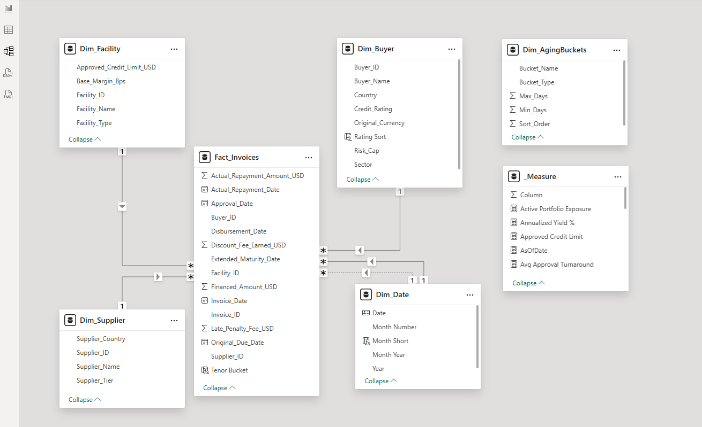

# Supply Chain Finance (SCF) — Financier Portfolio & Risk Analytics

An executive Power BI Command Center built for corporate banking and trade finance desks to monitor **credit risk, capital utilization, annualized yield, treasury cash inflows, and single-obligor covenant breaches** across a multi-currency Supply Chain Finance (Payables Finance) portfolio.

---

## Data Model Architecture (Star Schema)
The dataset (`800` financed invoices across `10` corporate buyers, `12` suppliers, and `3` bank facilities) is modeled as a pure **Star Schema**:

* **`Fact_Invoices`:** Granular invoice lifecycle dates (`Invoice_Date`, `Approval_Date`, `Disbursement_Date`, `Extended_Maturity_Date`, `Actual_Repayment_Date`), financed principals, settled amounts, and fee revenues.
* **`Dim_Buyer`, `Dim_Facility`, & `Dim_Supplier`:** Connected via `1:*` single-directional filters to `Fact_Invoices`.
* **`Dim_Date`:** Dynamically generated DAX calendar anchored to `Disbursement_Date` (active) and `Extended_Maturity_Date` (inactive).
* **`Dim_AgingBuckets`:** Disconnected lookup table classifying both overdue and upcoming maturity windows via signed day boundaries.

---

## Overview of the DAX engineering

* Dynamic Snapshot Date (AsOfDate): Anchored all time calculations to the dataset's latest funding date (MAX(Disbursement_Date)) instead of TODAY(), keeping historical portfolio snapshots accurate regardless of when the report is opened.
* Smart Delinquency Filtering: Built a 2-day clearing grace period (DATEDIFF > 2) on unpaid invoices so normal weekend bank settlement lags aren't miscounted as credit defaults.
* Disconnected Aging Ladder: Classified active exposure into both past-due and upcoming maturity buckets (1–7, 8–30, 31–60, 60+ days) using a disconnected lookup table without duplicating fact rows.
* Automated Risk & Capital Rules: Created conditional SWITCH logic to flag Basel III utilization bands (40%–75% optimal) and trigger row-level Breach alerts whenever a single buyer exceeds its internal credit cap.

---

## Executive Summary & Key Findings
* **Active Portfolio Exposure:** **$69.73M** across **$145.00M** in committed multi-currency credit facilities (**48.09% utilization** — inside the **40%–75% Basel III optimal target band**).
* **Delinquency & Aging Severity:** Overall delinquency sits at **3.02% ($2.10M)** after applying a 2-day weekend clearing grace period, segmented across `1–7 Days` ($1.08M), `8–30 Days` ($0.57M), and `31–60 Days` ($0.45M) past due.
* **Pricing Discipline & Yield:** Monthly fee revenue grew from **$225K (Jan)** to a peak of **$527K (Aug)** while maintaining a steady **6.5%–6.7% annualized yield**, confirming volume-driven growth without spread compression.
* **Treasury Liquidity & FX Ladder:** **$18.78M** in scheduled repayments due within the next 30 days across `USD`, `SGD`, `EUR`, and `MYR`.
* **Single-Obligor Covenant Breach Detection:** Automated risk-cap monitoring flags **MetroBuild Construction Group** (**$13.88M** active exposure vs. **$10.00M** internal risk cap) with an immediate crimson **Breach** alert.
  
## Tools & Technical Skills
`Power BI` • `DAX` • `Star Schema Data Modeling` • `Supply Chain Finance` • `Credit Risk Analytics` • `Treasury Liquidity Management` • `Custom JSON Theming`
